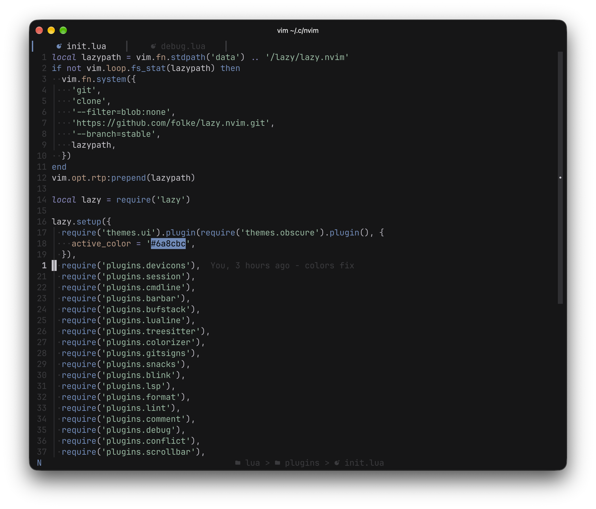

# Neovim Configuration

Opinionated Neovim config optimized for fast navigation, minimal UI noise, and sane defaults.



## Features

- **Navigation:** [Snacks.nvim](https://github.com/folke/snacks.nvim) smart file search, live grep, LSP pickers, and a floating explorer with preview.
- **Editing:** native Neovim LSP, [blink.cmp](https://github.com/Saghen/blink.cmp) completion, Treesitter highlighting, indentation guides, and symbol references.
- **Images:** Snacks image renders Markdown images inline in supported terminals such as Ghostty and Kitty, and opens image files directly in Neovim.
- **Git:** inline hunk previews and blame with [gitsigns.nvim](https://github.com/lewis6991/gitsigns.nvim), floating lazygit with delta, and merge conflict helpers.
- **Review:** local line comments with [fude.nvim](https://github.com/flexphere/fude.nvim), plus an optional MCP server for agent replies and thread resolution.
- **Tools:** floating shell terminals and Codex, Conform formatting, nvim-lint, and Python debugging with DAP.
- **Workspace:** automatic session save/restore, Barbar buffer tabs, recently closed buffers via bufstack, fuzzy command completion, and which-key hints.
- **Appearance:** [Obscure](https://github.com/mikovskii/obscure.nvim) syntax colors with a shared UI layer for flat backgrounds, muted inactive elements, consistent selections, and subdued diff colors.
- **Search:** hlslens match hints and nvim-scrollbar v2 with diagnostic, search, and Git markers.

## Requirements

The current plugin set requires **Neovim 0.12 or later**. The configuration is used on macOS; the Fude lock integration also supports Linux and requires LuaJIT's FFI and `flock`.

Install these before the first launch:

- Git for plugin installation.
- A C compiler, `curl`, `tar`, and **tree-sitter CLI 0.26.1 or later** for parser installation. Install tree-sitter CLI through a system package manager rather than npm, as required by the configured Treesitter version.
- `ripgrep` and `fd` for file search and grep.
- A terminal with true color, Alt/Option key support, and a [Nerd Font](https://www.nerdfonts.com/) for icons.

Feature-specific tools are installed separately; there is no automatic language-tool installer:

| Feature | Tools |
| --- | --- |
| Git UI | `lazygit` and `delta` |
| Images | ImageMagick (`magick`); a terminal supporting Kitty graphics, such as Ghostty |
| Codex terminal | `codex` on `PATH`, already authenticated |
| Python debugging | `python3` with `debugpy`; `VIRTUAL_ENV` selects the debuggee's interpreter |
| Agent review via MCP | `uv` and Python 3.12; see [MCP setup](mcp/README.md) |
| Input-source switching | `macism` on macOS, `im-select.exe` on Windows/WSL, or `fcitx5-remote`, `fcitx-remote`, or `ibus` on Linux |

Input-source switching is skipped if no supported command is available. The complete configuration's Fude lock adapter requires macOS or Linux even though the input-source plugin supports other platforms.

### Language tools

These are the configured LSP names and external executables. Install only those needed for your languages and make them available on `PATH`.

| Language | LSP configuration | Formatters | Linters |
| --- | --- | --- | --- |
| Python | `ty` | Ruff fixes, formatting, and import organization | `ruff` |
| Lua | `lua_ls` | `stylua` | `selene` |
| Go | `gopls` | `goimports`, `gofmt` | `golangci-lint` |
| Rust | `rust_analyzer` | `rustfmt` | `clippy` through Cargo |
| JavaScript / TypeScript / JSX / TSX | `vtsls` | `prettierd` or `prettier` | `eslint` for JavaScript / TypeScript |
| JSON | `jsonls` | `prettierd` or `prettier` | `eslint` |
| Nix | `nil_ls` | `nixfmt` | — |
| Swift | `sourcekit` | `swiftformat` | `swiftlint` |
| TOML | — | `taplo` | — |
| YAML | — | `prettierd` or `prettier` | — |
| XML | — | `xmllint` | — |

`codebook` is also enabled for spelling diagnostics on its supported filetypes. LSP configuration names are those used by nvim-lspconfig, and may differ from executable or package names.

Formatting is explicit: `Alt+s` formats and saves; `:Format` formats without saving and accepts a line range. Plain `:w` does not run Conform. Linting runs on buffer reads and writes. Formatter discovery and project-specific options are handled by the selected tool and Conform.

## Installation

Back up an existing `~/.config/nvim` directory before cloning. With no configuration already at that path:

```sh
git clone https://github.com/catvitalio/nvim-config.git ~/.config/nvim
nvim
```

[lazy.nvim](https://github.com/folke/lazy.nvim) bootstraps itself and installs plugins on first launch. Treesitter installs the configured parsers asynchronously; allow installation to finish before expecting highlighting. Use `:Lazy` to manage plugins, `:TSUpdate` after parser/plugin updates, and `:checkhealth` to diagnose missing dependencies.

The scrollbar currently tracks `refactor/v2`, as recorded in its plugin spec and `lazy-lock.json`.

Clipboard operations use OSC 52 for both copy and paste. The terminal must support and permit those operations, including any terminal multiplexer in between.

On macOS, configure the terminal to send Option as Alt/Meta. Some Alt combinations, especially `Alt+Space`, `Alt+Esc`, and shifted digits, may need terminal or system shortcut adjustments.

### Lazygit syntax colors

Diff backgrounds and lazygit UI colors are derived from the active Neovim theme. Lazygit launches delta with the syntax theme named **Obscure** when that colorscheme is active.

The matching `Obscure.tmTheme` is an external bat theme and **is not included in this repository**. A fresh clone does not install it. To enable matching syntax colors, place that theme in bat's configuration directory under `themes/`, run `bat cache --build`, and verify that `delta --list-syntax-themes` includes `Obscure`. Without it, change the syntax theme selection in [lua/themes/delta.lua](lua/themes/delta.lua) to an installed theme or `none` before using lazygit. Other Neovim colorschemes currently select `none` automatically.

## Key bindings

`Leader` is **Space**. `Alt` is Option on macOS when configured to send Meta. These are the configuration's main mappings; plugin commands and native Vim motions remain available.

### Navigation and buffers

| Key | Action |
| --- | --- |
| `Alt+e` | Floating file explorer with preview |
| `Alt+p` | Smart file picker |
| `Alt+f` | Live grep |
| `gd` / `gr` | LSP definitions / references picker |
| `Alt+.` | LSP code action |
| `Alt+s` | Format and save |
| `Alt+[` / `Alt+]` | Previous / next buffer |
| `Alt+1` … `Alt+9`, `Alt+0` | Go to buffer 1 … 10 |
| `Alt+w` / `Alt+Shift+w` | Delete buffer / force delete |
| `Alt+Shift+t` | Reopen a closed buffer |
| `Space+h/j/k/l` | Focus adjacent window |
| `Space+s` / `Space+v` | Horizontal / vertical split |
| `Space+q` / `Space+o` | Close current / other windows |
| `Space+?` | Show leader mappings |
| `Esc` in Normal mode | Clear search highlighting |

The explorer uses a floating tree and preview pane. Hidden and ignored files are shown, except `.git`. Use `h` / `l` to navigate directories, `P` to toggle preview, and Enter to open a file and close the picker.

Command-line completion for `:`, `/`, and `?` uses cmdline.nvim; cycle suggestions with Tab / Shift+Tab. Insert completion uses blink.cmp's `enter` preset; Ctrl+Space shows or hides its menu.

### Git, terminals, and review

| Key | Action |
| --- | --- |
| `Alt+g` | Toggle lazygit |
| `Alt+Shift+g` | Open lazygit for the current file and search for the line's blame commit |
| `Alt+i` | Preview the current Git hunk inline |
| `Alt+Space` | Toggle Codex for the current working directory |
| `Alt+Shift+1` … `Alt+Shift+9`, `Alt+Shift+0` | Toggle shell terminal 1 … 10 |
| `Alt+Esc` in Terminal mode | Enter terminal Normal mode |
| `Space+rr` / `Space+rq` | Start / stop local review |
| `Alt+r` in Normal or Visual mode | Add a review comment; starts a review if needed |
| `Alt+Shift+r` | Resolve or reopen a review thread on the current line |
| `Alt+Shift+d` | Delete a review comment on the current line |
| `Space+rv` / `Space+rl` | View line comments / list review comments |
| `Space+rf` / `Space+rp` | Review changed files / toggle review panel |
| `]r` / `[r` | Next / previous review comment |

Only one managed floating terminal is shown at a time. Toggle it with its shortcut to hide it while preserving the process. Codex first tries `codex resume --last`, then starts a new session if that fails. In terminal Normal mode, use Vim motions to inspect the buffer and `i` to return to terminal input. Full-screen terminal applications may keep their own history outside Neovim's scrollback.

The optional review MCP server reads and updates local Fude threads; it does not publish GitHub comments. Setup, protocol details, and tests are documented in [mcp/README.md](mcp/README.md).

### Python debugging

| Key | Action |
| --- | --- |
| `Alt+d` | Toggle DAP UI |
| `Alt+b` | Toggle breakpoint |
| `F5` / `Shift+F5` | Continue / terminate |
| `F10` / `F11` / `Shift+F11` | Step over / into / out |

## UI customization

[Obscure](lua/themes/obscure.lua) supplies syntax colors. [themes.ui](lua/themes/ui.lua) derives interface colors from the active colorscheme and applies them to floating windows, pickers, completion, lazy.nvim, Barbar, lualine, and Git highlights. Devicons map their original color categories to highlight groups from the current theme.

The theme and shared UI are connected in [lua/plugins/init.lua](lua/plugins/init.lua):

```lua
require('themes.ui').plugin(require('themes.obscure').plugin(), {
  active_color = '#6a8cbc',
})
```

Change `active_color` for the mode indicator, active tab separators, picker and command-line matches, and lazygit's active border. Backgrounds and muted text come from the colorscheme; selection and diff backgrounds are blended from its colors. The shared layer reapplies after colorscheme and lazy-plugin changes. Restart lazygit to pick up updated colors.

## Repository layout

| Path | Purpose |
| --- | --- |
| [init.lua](init.lua) | Entry point; VSCode Neovim mode skips the standalone plugin configuration |
| [lua/plugins/init.lua](lua/plugins/init.lua) | lazy.nvim bootstrap and plugin list |
| [lua/plugins/](lua/plugins/) | Plugin options and key bindings |
| [lua/settings.lua](lua/settings.lua) | Editor options, clipboard, diagnostics, window mappings, and sensitive-file detection |
| [lua/themes/](lua/themes/) | Obscure setup, shared UI styling, and delta arguments |
| [lua/utils/](lua/utils/) | Fude lock adapter and JSON environment helper |
| [queries/nix/injections.scm](queries/nix/injections.scm) | Nix language injections |
| [mcp/](mcp/) | Optional local Fude review MCP server and its tests |
| [tests/theme_ui.lua](tests/theme_ui.lua) | UI integration check |
| [lazy-lock.json](lazy-lock.json) | Plugin revision lockfile |
| [assets/screenshot.png](assets/screenshot.png) | README screenshot |

Sensitive filename patterns are assigned the `sensitive` filetype. This is filetype detection, not a general mechanism for preventing external tools from reading files.

## Verification

Install the commit checks once per clone:

```sh
uv tool install pre-commit
brew install selene
pre-commit install
pre-commit run --all-files
```

On Linux, install Selene through your package manager or `cargo install selene --locked` instead of Homebrew. StyLua and Ruff are installed automatically in isolated pre-commit environments. Selene must be on `PATH` when committing.

The hooks format Lua with StyLua, lint Lua with Selene, and lint/format Python with Ruff using `mcp/pyproject.toml`. Selene allows Neovim's `vim`, Snacks' `Snacks`, and LuaJIT's `bit` globals; mixed tables and `_G` access are allowed for plugin specs and editor callbacks. Formatting hooks modify files; review and stage their changes before retrying a commit.

With plugins and the external Obscure bat theme installed:

```sh
nvim --headless '+luafile tests/theme_ui.lua' +qa!
```

This checks theme changes, UI backgrounds and accents, explorer preview, icons, and delta diff backgrounds. MCP checks are listed separately in [mcp/README.md](mcp/README.md).
